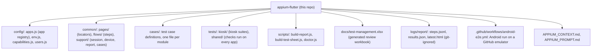
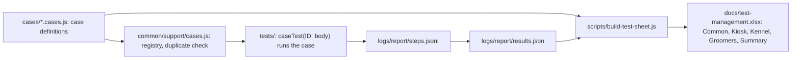
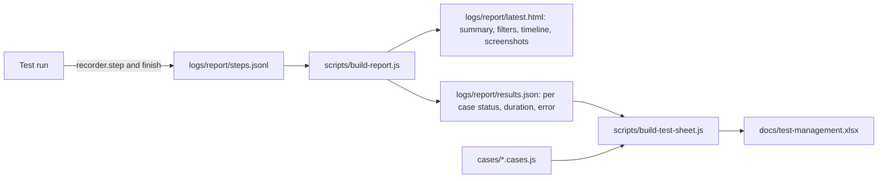
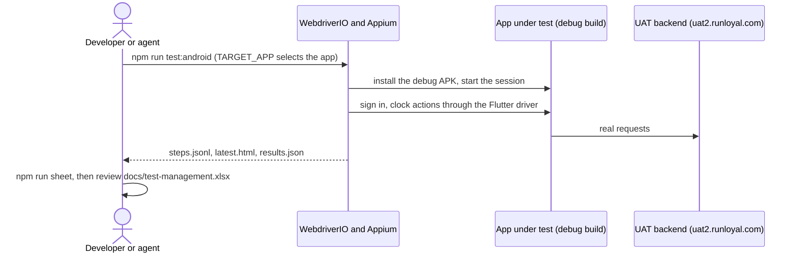

# Appium Automation Testing: Context for Developers and AI Agents

This is the central technical reference for the RunLoyal staff-app test suite in this repository.
Read it before changing tests, cases, the report or the workflow. The diagrams describe the code as it
is. Update them whenever the structure changes.

## 1. Objective

One suite drives every RunLoyal staff app on Android and iOS:

- **kiosk** (`apps/kiosk`): sign-in, employee clock lifecycle, wrong-PIN rejection.
- **kennel** (`apps/kennel`) and **groomers** (`apps/groomers`): the shared sign-in and each app's access check.

The suite uses WebdriverIO with the `flutter` driver (appium-flutter-driver) and UiAutomator2 on
Android. The Flutter driver needs a **debug** build with `enableFlutterDriverExtension()` in
`main.dart`. Release builds cannot be driven.

Every test is a **test case** with an ID. Reviewers read the cases in a generated Excel workbook,
and the run results land in the same workbook.

## 2. Source code the suite reads

| App | Path (read-only reference) | Notes |
|---|---|---|
| kiosk | `/Users/runloyal/RunLoyal/Flutter/kiosk-turbo/staff-turbo-flutter/apps/kiosk` | Own login screen (`kiosk_login_*` keys). Clock dialog keys in `employee_clock_dialog.dart`. |
| kennel | `/Users/runloyal/RunLoyal/Flutter/staff-turbo-flutter/apps/kennel` | Uses the shared `LoginGate` (`staff_login_*` keys). |
| groomers | `/Users/runloyal/RunLoyal/Flutter/staff-turbo-flutter/apps/groomers` | Uses the shared `LoginGate` (`staff_login_*` keys). |

Shared login: `packages/staff_app_ui/lib/screens/login/login_gate.dart`. Access flags from the login
response: `packages/logic/lib/repositories/auth_repository.dart` (`hasKioskAccess`,
`hasStaffAppPlusKennelAccess`, `hasStaffAppPlusGroomerAccess`).

Biometric setup sheet (kennel, groomers): `packages/staff_app_ui/lib/screens/login/widgets/biometric_setup_sheet.dart`.
`login_gate.dart` opens it after a successful sign-in when the device has Face ID or a fingerprint and
biometric login is off. Its Enable switch, Done and Skip for now are what the sign-in flow handles. The
groomers app has a second copy of this file that nothing imports; the suite follows the shared one.

Kennel and groomers can only be driven after their `main.dart` calls `enableFlutterDriverExtension()`
and their login exposes `staff_login_*` keys. These changes live in the Flutter checkout. See
"Known issues".

## 3. Project structure

## 4. Test case model

Every test is a case. A case has these fields, which are the columns of the review sheet:

| Field | Meaning |
|---|---|
| Test Case ID | `<MODULE>-<NNN>`, for example `LOGIN-001`, `KIOSK-CLK-001`, `KENNEL-ACC-001`. Unique across all modules. |
| Module | `Common`, `Kiosk`, `Kennel` or `Groomers`. |
| App | Apps that run the case: `kiosk`, `kennel`, `groomers`. |
| Test Scenario | Short name of the behaviour. |
| Test Description | What is checked and why. |
| Preconditions | Accounts, location and app state needed before the run. |
| Test Steps | Ordered steps, one per line. |
| Expected Result | Observable outcome. |
| Actual Result | Filled from the last run. |
| Test Status | `Pass`, `Fail` or `Pending`. Filled from the last run. |
| Automation Status | `Automated`, `Manual` or `Not Implemented`. |
| Remarks | Reviewer notes. Kept across regenerations. |
| Last Run | Time and environment of the last run that executed the case. |

Cases are defined **in code**, in `cases/`. `common/support/cases.js` rejects duplicate IDs. The
sheet is generated from the code, so the sheet always matches the cases that exist.

## 5. Adding or changing a test case

1. Add the case to the right file in `cases/` (`common.cases.js`, `kiosk.cases.js`, `kennel.cases.js`,
   `groomers.cases.js`). Use the next free number for its module.
2. Implement the test in `tests/` and wrap its body with `caseTest('<ID>', async () => { ... })`.
   The test uses the existing flows (`common/flows/`) and pages (`common/pages/`). Do not add locators
   inline in a test.
3. If the case is not automated yet, add it with `Automation Status: Not Implemented` and say why in
   its Preconditions or Remarks. Do not mark it as passed.
4. Run the test, then `npm run sheet`. Check the workbook.
5. Never report a case as passed without a successful run. Never invent results.

## 6. Module rules

- **Common** holds checks on the sign-in screens. Each case lists its apps in the App column, and the
  test runs once per listed app. LOGIN-001 runs on all three apps. LOGIN-004 and LOGIN-005 (biometric
  setup sheet) list only kennel and groomers, because the kiosk login has no such sheet.
- **Per-app modules** (Kiosk, Kennel, Groomers) hold behaviour specific to one app, such as the clock
  lifecycle or an access check.
- A new module needs: a case file in `cases/`, a tab name in `scripts/build-test-sheet.js`, and a
  section in this document.

## 7. Automation conventions

- Locators come from `common/pages/` only. Use `byValueKey` for Flutter widgets. Every widget the
  suite drives needs a `Key` in the app code. Tests never use text as a locator unless the text is
  part of the behaviour under test. The one exception today is the biometric setup sheet's
  "Skip for now" button, found by its label in `common/pages/biometric-setup.page.js` until the app
  gives it a key.
- Flows take an optional `recorder` and call `recorder.step(name)` at each meaningful point. Those
  steps become the timeline in the report.
- Config comes from `loadSuiteConfig()`. It reads `TARGET_APP` and throws a clear error when a
  variable is missing.
- Clock actions write real timesheet rows to UAT2. Run them on UAT2 only, and never on PROD without
  an explicit decision.
- A Flutter `waitFor` timeout is not a test failure by itself. The `waitUntil` helpers only fail
  after their deadline, and they surface on-screen error text immediately.

## 8. Commands

| Command | What it does |
|---|---|
| `npm run doctor` | Checks Appium, the device and that a session can start. |
| `npm test` | iOS kiosk suite, one shared session. |
| `npm run test:login` | iOS login check. |
| `npm run test:clock-in` | iOS clock lifecycle. Writes real rows. |
| `npm run test:clock-in-wrong-credentials` | iOS wrong-PIN check. Writes nothing. |
| `npm run test:android` | Android kiosk suite (3 cases). |
| `npm run test:android:login` | Shared sign-in check on the Android app named by `TARGET_APP`. |
| `npm run test:kiosk-main` | Kiosk check-in and check-out boxes, visit-type cards, Continue routing and the QR squares. Read-only. |
| `npm run test:new-client` | New client QR dialog, owner form and pet form. KIOSK-NEW-001 to 004 are read-only. KIOSK-NEW-005 to 007 are in `npm run test:new-client:write`. |
| `npm run test:new-client:write` | QA owner and pet writes to UAT2 (KIOSK-NEW-005 to 007). Every run creates real rows, so run it only on purpose. |
| `npm run test:qa-data` | Offline checks of the QA owner and pet data helpers. No device needed. |
| `npm run report` | Rebuilds `logs/report/latest.html` and `results.json` from recorded steps. |
| `npm run test:local` | Interactive local runner: asks for iOS or Android and kiosk, kennel or groomers, builds if needed, starts the device and Appium, runs the suite, rebuilds the report and the sheet, opens the report. |
| `npm run sheet` | Regenerates `docs/test-management.xlsx` from the cases and the last results. |

Every `test*` script runs the report build at the end, pass or fail.

## 9. Reporting and result sync

- The HTML report is a single file. Screenshots are embedded, and the loose PNGs are deleted after the
  build.
- `results.json` has one entry per case run: ID, module, app, status, duration and error.
- On Android CI the workflow runs `npm run sheet` after the tests and uploads the report, the
  workbook, the logcat dump of any failed clock test, and failure screenshots.

## 10. Execution flow

## 11. Android CI

`.github/workflows/android-e2e.yml` (workflow_dispatch only):

1. Inputs: `apk_url`, `app`, `device_type` (`mobile` or `tablet`), `target_environment` (`UAT2` or `PROD`).
2. Resolves `TARGET_APP` from the app choice: kiosk → `kiosk-android`, kennel → `kennel-android`,
   groomers → `groomers-android`.
3. Downloads the debug APK and checks it is an APK.
4. Boots a GitHub-hosted emulator with `-memory 4096`. Mobile is `pixel_6`; tablet is `pixel_tablet`.
5. Runs `npm run test:android` for the kiosk, or `npm run test:android:login` for kennel and groomers.
6. Runs `npm run sheet` and uploads the report, the workbook, logcat and failure screenshots.

Each run writes real rows to UAT2 when the clock tests pass. Ask before starting one.

## 12. Known issues

- **Emulator stalls.** A busy emulator can freeze a system app and raise "isn't responding". The clock
  waits tap "Wait" on that dialog. The emulator still hangs in some runs. Logcat shows the cause:
  `mem-pressure-event` or a restarted Play services location service.
- **Cascade after a clock failure.** A failed lifecycle test can leave the clock dialog open. The
  wrong-PIN test then cannot open the dialog and fails. Closing the dialog needs a key on its close
  button in the kiosk app.
- **Kennel and groomers need the driver hook.** Until `enableFlutterDriverExtension()`, the
  `staff_login_*` keys and the `flutter_driver` dependency are in the Flutter checkout, those apps'
  tests cannot run.
- **Biometric setup sheet (kennel, groomers).** After each sign-in the sheet opens until biometric
  login is turned on for the device. The sign-in flow taps Skip for now, so every other check still
  gets through. LOGIN-004 needs the sheet to appear, which needs Face ID or a fingerprint enrolled on
  the device; without it the case fails with a clear message. LOGIN-005 (turning the switch on) needs a
  biometric match the suite cannot give yet, so it is `Not Implemented`. While the sheet is open, the
  Sign in button keeps its spinner running, and Flutter Driver's frame-synced waits never finish. The
  sign-in flow therefore turns frame sync off for the sign-in window only (`flutter:setFrameSync` in
  `common/flows/staff-login.flow.js`) and turns it back on afterwards.
- **Negative access checks need accounts.** Accounts without the kennel, groomer or kiosk flag are
  needed. Until they exist, those cases are `Not Implemented`.

- **Kiosk new-client screens have no Flutter Keys.** Tests match visible text. The QR squares are found by
  widget type (`KioskQrSquareButton`), and the QR scanner by `CustomerQrScannerScreen`. Keys would make these
  more stable.
- **The visit-type headline is rich text.** "How are you visiting?" cannot be matched by text, so the
  "Back to home" chip marks that screen.
- **Opposite default flags.** The check-in and check-out boxes show unless their flag says `hide == false`.
  Visit-type cards show only when their flag says `hide == true`, so a missing flag hides the card. Confirm
  this is intended.
- **QA owners and pets stay in UAT2.** The kiosk has no delete for owners or pets. The `QA-` names and the
  `dharunraj+<date><NN>` emails make them easy to find later.
- **Write cases are separate.** KIOSK-NEW-005 to 007 run only with `npm run test:new-client:write`, which writes real rows to UAT2 on every run.
  Their sheet status stays Pending until that command runs.
- **Frame sync and animations.** The QR scanner and the owner form have repeating animations or spinners.
  Flutter driver waits for frame sync before each command, so those screens hang every later call. The QR
  and new-client sessions turn frame sync off (`common/support/frame-sync.js`). Each navigation case runs
  in its own session, because Continue pushes a route that stays mounted underneath.

- **Order in the shared suites.** Sign-in, then the clock lifecycle (KIOSK-CLK-001), then the wrong-PIN check
  (KIOSK-CLK-002), which closes its dialog. Then Continue on the location screen (KIOSK-CLK-003) opens the
  check-in/check-out screen.

## 13. Rules for AI agents

1. Read this file and the diagrams before you change anything.
2. Read the existing test, flow and page before you change it. Keep working behaviour.
3. Add cases in `cases/`, never only in a test. Keep IDs unique.
4. Never report a case as passed without a successful run. Do not invent results.
5. Clock actions write to UAT2. Ask before running them.
6. Keep this file and its diagrams in step with the code.
7. Finish with a summary: what changed, what passed or failed, and what is still pending.
